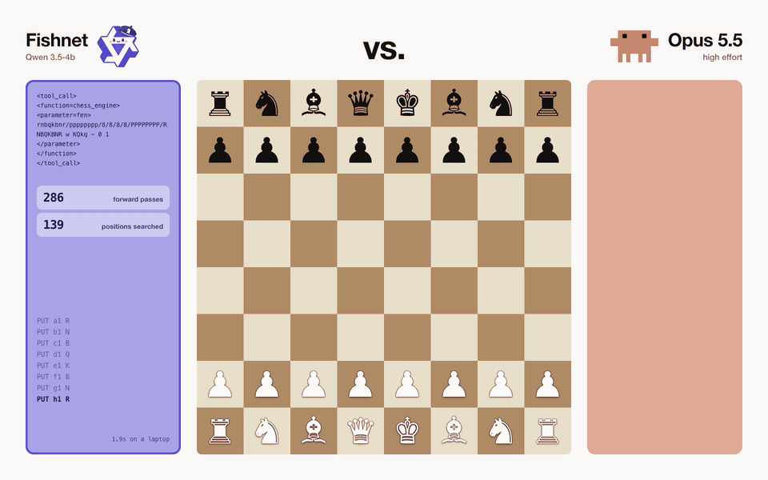

# fishnet

a chess engine compiled into Qwen3.5-4B's weights. 

built on top of [Qwenputer](https://github.com/divagr18/qwenputer), there are extra layers that add an alpha-beta search with gated delta nets and swiglus. computation is done purely in forward passes.



## play with it yourself:

this works on a macbook with at least 16gb of ram:

```sh
./setup.sh
./play.sh
```
